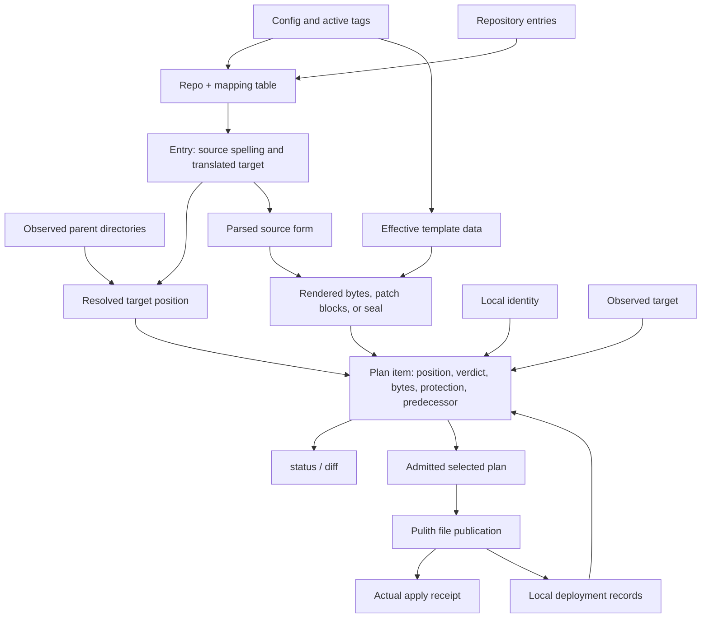

# tuckin architecture

[简体中文](architecture.zh-CN.md) · [Tutorial](../README.md) · [Behavior specification](spec.md)

## What the repository controls

A repository assigns a source spelling to each managed file. Its mapping and the current platform together give that source one target. A machine's tags can exclude entries and supply template values. Each admitted source owns either the bytes of its entire target or the ranges found by its patch locators. A seal supplies bytes to either form and requires private publication of the entire file. Source ownership is decided before reading the selected contents, so a single-file operation and a whole-repository operation agree on where that file belongs.

## Objects and their relations

| Object and owner | Responsibility |
| --- | --- |
| [Configuration](../src/config.rs) and [data](../src/data.rs) | Parse declarations into map rows, ignore rules, recipient policy, and raw data. The template context overlays OS and tag layers when a command needs values. Both file and script admission use the scan's active tags. |
| [Spelling and mapping table](../src/spell.rs) | Bind a repository path to a platform destination, retaining the distinction between a source name and a machine path. The table covers symbolic target comparisons and resolves system directories once per table. |
| [Repository and entries](../src/scan.rs) | Own the root, table, admitted entries, and machine inputs for one run. An entry couples the spelling with the translated destination. Placement resolves destination parents and detects actual aliases, parent-file conflicts, and collisions with the repository or identity. |
| [Content forms](../src/content.rs) and [patch locators](../src/patch.rs) | Interpret a source as literal or rendered whole-file bytes, a whole-file seal, or ordered patch blocks. Each patch block carries its locator and body. Write-back uses the same source interpretation with original source spans. |
| [Vault and recipients](../src/seal.rs) | The vault opens existing ciphertext with local identities. Recipients select public keys for new ciphertext. Identity location is also an input to placement, so even a command with no selected seals respects the reserved key position. |
| [File plan](../src/plan.rs) | Pair the resolved position and source result with an observation of the target. Each item carries the expected bytes, verdict, privacy requirement, and any publication condition derived from the observed bytes. |
| [Reports](../src/out.rs) and [publication](../src/commit.rs) | The report projects plan data. Publication submits the planned bytes and admission conditions to Pulith, then counts actual outcomes. |

## Trace a patch from preview to write

Suppose `home/@config/zed/settings.json` declares a line patch. The table first maps its source spelling using the chosen platform row. The scan checks the complete ownership layout. Then the planner resolves the target position and reads that entry's source and existing target. All blocks locate their ranges on the same input. Each replacement preserves the surrounding bytes and its locators. Re-evaluation on the candidate output establishes that applying those same bodies again would produce no byte changes.

`diff` projects the candidate and its verdict. A standalone `apply` makes a fresh plan and admits the selected batch before it reaches publication. The planner compares each managed range with its local record. A line locator owns its suffix, a between locator owns its interval, and a whole source owns the file. The plan supplies the full observed digest for any replacement and requires a free destination for creation. Pulith checks that condition at publication. Actual file outcomes are retained for the receipt, including when the script phase fails.

Planning validates placement for the admitted repository and evaluates content for the selected entries. This keeps per-file previews meaningful without reading the contents of all other files. The comparison view may do bounded line work beyond the file plan. Neither that projection nor the script cache supplies permission for a file write.

## Effects and recovery

[Deployment records](../src/state.rs) keep keyed fingerprints for each resolved destination and locator independently of the Git revision and script cache. A repository-scoped edit session coordinates `apply` and ordinary `absorb`. Each replacement invalidates its previous record before publishing and confirms the new record from the publication outcome. A missing record leaves existing differing bytes protected. The session ends before scripts run.

Tuckin decides **which** file positions to manage, **what** bytes to write, and **under what condition**. Pulith owns local type observations, opened files, staging and replacement, digest admission, and private access on the staged file. A sealed write asks for a private staging operation before plaintext is written. Tuckin reports unavailable platform support during planning when it can identify it, and requests protection repair if a target already agrees by byte.

A complete selected file plan precedes target publication. Each file has its own publication boundary. An error leaves the completed prefix in place. Retrying starts from new observations. This is a file-scoped guarantee on the operations Pulith admits. Directory resolution and a preview do not grant an immutable snapshot of the whole machine.

Source writes follow the same division of responsibility. `add` supplies a missing-source condition. `absorb` collects only representable source bytes and carries the digest of the source it used. Writing back a sealed body keeps the original sealed representation when its plaintext is unchanged. Creating an identity is create-only and private. Binding the first recipient is a subsequent conditional configuration write, so retries can reuse an identity created before a configuration write failed.

## Script lifetime

The [script phase](../src/scripts.rs) derives its own ordered script list from repository admission and public template data. Its interpreter is chosen by extension. [Gate records](../src/gate.rs) can remove already successful tasks from the runnable list before executable lookup. The remaining runtimes and temporary script products are prepared before file writes. Programs then run in the repository root after those writes. Their effects follow the calling account's authority. A script failure retains file writes and effects from programs already run. Gate records are updated after the phase succeeds.

The [behavior specification](spec.md) defines supported syntax, command results, and diagnostics.
