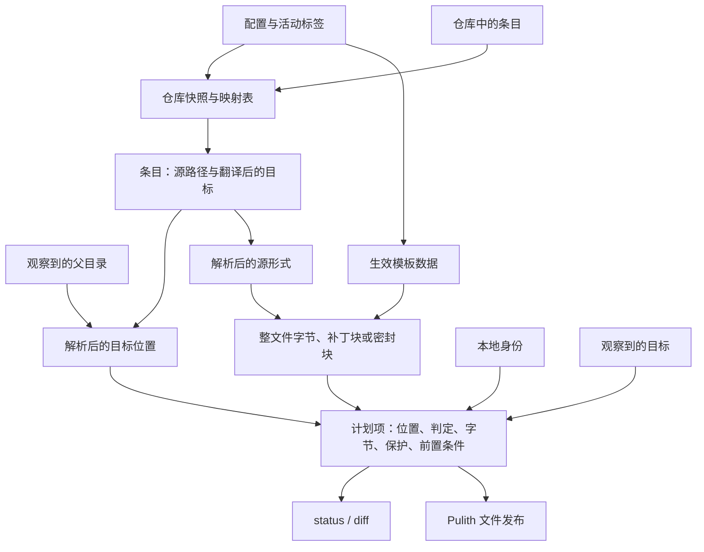

# tuckin 架构

[English](architecture.md) · [使用教程](../README.zh-CN.md) · [行为规范](spec.zh-CN.md)

## 仓库管理什么

仓库用源路径标识每个受管理的文件。映射表与当前平台共同确定一个源的目标位置。本机标签可以排除条目或提供模板值。每个入选源管理整个目标的字节，或管理由补丁定位器找到的范围。密封块给这两种形式提供字节，并要求整个目标以私有方式发布。文件内容在确定归属之后才读取，因此单文件操作和全仓操作对该文件的目标位置采用同一解释。

## 对象及其关系

| 对象与归属 | 责任 |
| --- | --- |
| [配置](../src/config.rs)与[数据](../src/data.rs) | 把声明读成映射行、忽略规则、收件人策略和原始数据。命令需要模板值时，按 OS 和标签叠加。文件和脚本使用扫描时读取的同一组活动标签。 |
| [源路径与映射表](../src/spell.rs) | 将仓库路径绑定到各平台的目标，保留源名称与机器路径的区别。映射表支持符号目标比较，每张表只解析一次系统目录。 |
| [仓库与条目](../src/scan.rs) | 保存一次运行的仓库根、映射表、入选条目和本机输入。一个条目关联源路径与翻译后的目标。位置解析处理目标父目录，检测实际别名、父目录冲突、仓库冲突和身份路径冲突。 |
| [源形式](../src/content.rs)与[补丁定位器](../src/patch.rs) | 把源解释为字面或渲染后的整文件字节、整文件密封块、或有序补丁块。每个补丁块持有定位器和块体。回写沿用同一套源解释，并使用原始源跨度。 |
| [身份与收件人](../src/seal.rs) | 本地身份解开已有密文。收件人选择生成新密文的公钥。身份位置也参与位置解析，因此即使未选择任何密封源，也会保留密钥文件的位置。 |
| [文件计划](../src/plan.rs) | 将解析后的目标位置、源计算结果和目标观察组合成计划项。计划项携带期望字节、判定、私有保护要求，以及基于所观察字节的发布条件。 |
| [报告](../src/out.rs)与[发布](../src/commit.rs) | 报告是文件计划的投影。发布将计划内的字节和准入条件交给 Pulith，并按实际结果计数。 |

## 一份补丁从预览走到写入

假设 `home/@config/zed/settings.json` 声明一个行补丁。映射表先根据平台行翻译源路径，扫描确认整个仓库的目标归属。规划器随后解析目标位置，读取该文件的源声明及现有目标。各块在同一份输入上定位。替换保留范围以外的字节和定位文本。对候选输出重新求值，确认相同的块体再执行一次无需改动字节。

`diff` 输出文件判定，之后单独运行的 `apply` 会重新规划。补丁写入计划携带推导新字节所依据的目标摘要，Pulith 发布时要求该前置条件成立。期间若有另一个进程修改了目标，重试会基于新输入重新规划。整文件源自己提供完整内容，允许创建缺失文件或替换普通文件。如果普通文件在预览后出现或消失，实际发布结果可能与预览不同。

规划覆盖全部入选条目的位置，只求值被选择的内容。单文件预览由此共享全仓的目标归属，无需读取其他文件的内容。详细预览可在文件计划上追加有界的文本比较。报告和脚本缓存都不提供写入许可。

## 效果与恢复

Tuckin 决定管理**哪个位置**、写入**哪些字节**和**附带什么条件**。Pulith 负责本地对象观察、打开文件、暂存与替换、摘要准入，以及在暂存文件上建立私有访问权限。密封写入要求先建立私有暂存能力，再写明文。对已知不支持的平台，Tuckin 在规划阶段报告。目标字节一致但保护不足时，计划要求修复保护。

所选文件在发布前全部完成规划。发布以单文件为边界，失败会保留此前已成功写入的文件。重试重新观察。这个保证针对 Pulith 接受的文件操作，目标解析与预览无法冻结整台机器的状态。

源写入沿用同样的责任划分。`add` 只允许在缺失源的位置写入。`absorb` 只采集可表达的字节，并携带所依据的源摘要。密封块的明文字节无变化时保留原密文。身份生成只在位置缺失时私有创建。然后以单独的条件写入绑定首个收件人。若配置写入失败，重试可复用已建身份。

## 脚本生命周期

[脚本阶段](../src/scripts.rs)从仓库的入选规则和公开模板数据生成单独的有序列表，按扩展名选择解释器。[Gate 记录](../src/gate.rs)在查找解释器之前排除可复用成功结果的脚本。文件发布前准备余下脚本需要的解释器和临时产物，文件发布后才在仓库根运行。程序效果由调用账户的权限决定。脚本失败时保留已发布的文件及先前程序的效果。整个阶段成功后才更新 Gate 记录。

支持的语法、命令输出与诊断见[行为规范](spec.zh-CN.md)。
